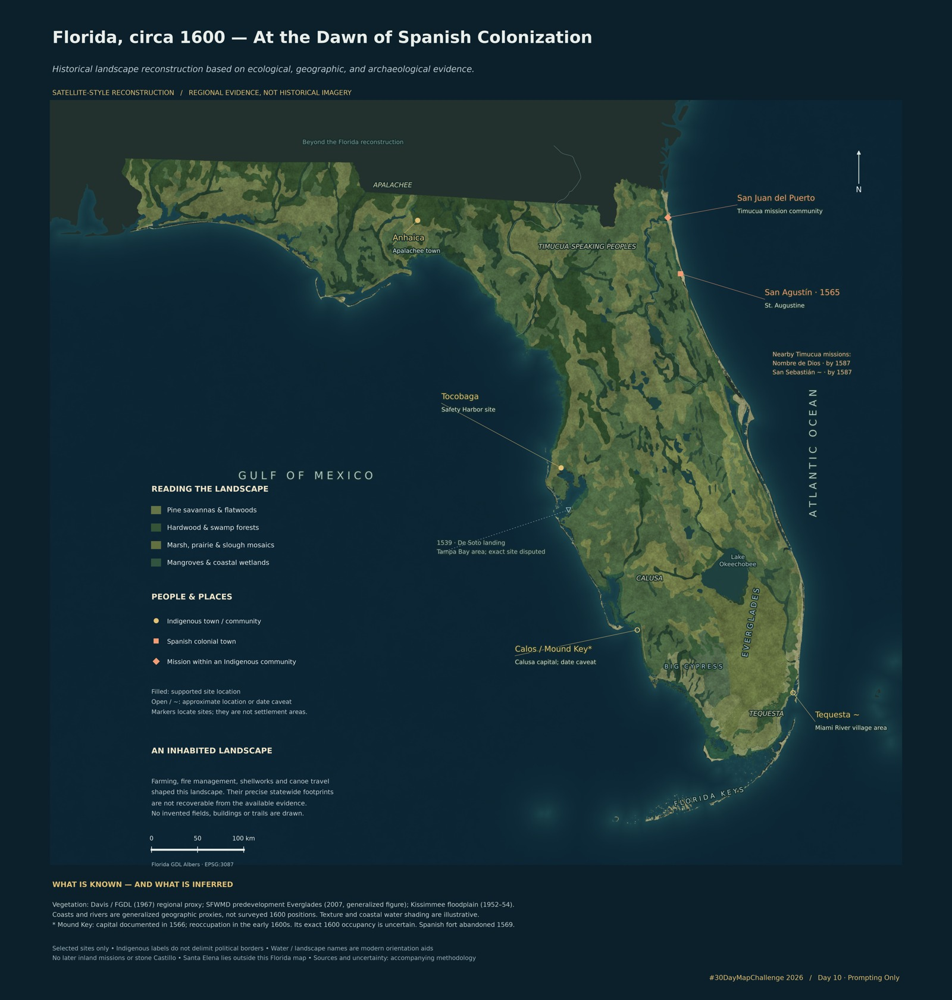

# Florida, circa 1600

**#30DayMapChallenge 2026 · Day 10 · “Prompting Only” · November 10**

The [official Day 10 theme](https://30daymapchallenge.com/#2026-themes) asks participants to have AI produce a map from start to finish through chat or the command line. Husayn El Sharif supplied the historical and visual brief and directed the work through prompts; OpenAI Codex researched sources, authored and ran the Python workflow, inspected renders, and prepared this repository. This is a prompting-only challenge entry, not an assertion that every scientific assumption has been independently validated. AI-generated code and editorial judgments are documented and reviewable.



[Full-resolution PNG](outputs/Florida_circa_1600.png) · [Methodology and uncertainty](METHODOLOGY.md) · [Evidence provenance](outputs/Evidence_provenance.png)

An evidence-led, statewide minimum viable reconstruction for #30DayMapChallenge. Created 10 November 2026. This is a synthetic satellite-style cartographic rendering, **not an actual image, a surveyed 1600 land-cover map, or a validated paleohydrological simulation**. Its strongest evidence is regional ecology and selected historical site identifications. Fine landscape texture is illustrative.

## Deliverables

- `outputs/Florida_circa_1600.png`: 6000 × 6300 pixels, 300 dpi; labeled presentation map.
- `outputs/Florida_circa_1600_preview.jpg`: compact preview.
- `outputs/Evidence_provenance.png`: visual guide to the spatial evidence sources.
- `outputs/satellite_style_rgb.tif`: unlabelled, projected RGB GeoTIFF.
- `outputs/landscape_classes.tif`: categorical landscape proxy, with `class_legend.json`.
- `outputs/evidence_provenance.tif`: source / inference code at every mapped cell.
- `outputs/reconstruction.gpkg`: reference vegetation, historical sites, registered Everglades proxy polygons, Kissimmee reference polygons and selected river proxies.
- `outputs/historical_sites.geojson` and `.csv`: selected sites with sources and separate spatial and temporal qualifications.
- `outputs/build_manifest.json`: input checksums, software versions, raster geometry and class/provenance pixel counts.
- `METHODOLOGY.md`: evidence, assumptions, exclusions and improvement priorities.

## Reproduce

Python 3.14 was used on Windows. From this folder in PowerShell:

```powershell
python -m venv .venv
& .\.venv\Scripts\python.exe -m pip install -r requirements.txt
& .\.venv\Scripts\python.exe fetch_data.py
& .\.venv\Scripts\python.exe build_map.py
& .\.venv\Scripts\python.exe validate.py
```

The downloaded inputs are cached in `data/`; retain them with their checksums for exact input reproducibility. Fresh downloads can change upstream. No API key is required; `.env` is neither loaded nor packaged. A fixed random seed (1600) reproduces the texture. Numeric and image encoding differences across platforms remain possible. Re-running replaces only this project's named output files and GeoPackage layers.

The public repository contains the presentation PNG, preview, provenance plate, compact site data and audit metadata. Source download caches, the report PDF, GeoTIFFs and the GeoPackage remain local and are regenerated by the commands above. No Git LFS is required. Original source data are attributed rather than republished wholesale.

## Interpretation

Use at statewide scale. A 250 m raster cell is a rendering choice, **not** a claim of 250 m historical accuracy. Modern geographical names identify water bodies and landscapes; they do not assert the names in use in 1600. Site markers are deliberately symbolic and are not village areas. The selected sites do not form a census of Indigenous communities or missions.

The map preserves human presence through named Indigenous towns, mission communities and explanatory text. It does not invent clearings, trails, houses or village polygons where their location or extent is unsupported. This limits its local photorealism, but avoids replacing uncertainty with fabricated evidence.
